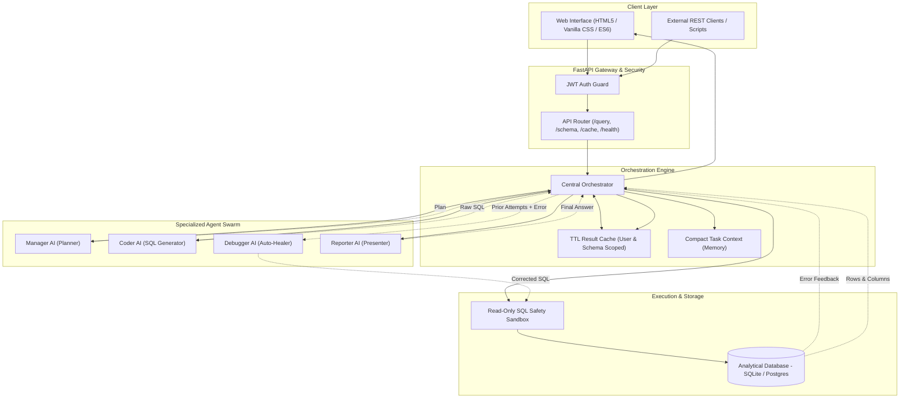
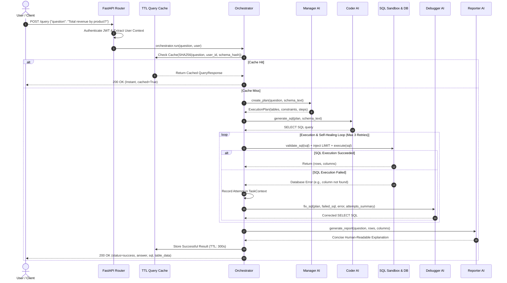

# System Architecture & Technical Specification — Auto Analyst

Auto Analyst is an enterprise-grade, multi-agent AI system that converts natural-language business questions into verified analytical SQL, executes them in a sandboxed read-only environment, automatically heals broken queries, and presents clear insights.

---

## Table of Contents
1. [Executive Summary & Purpose](#1-executive-summary--purpose)
2. [Technology Stack](#2-technology-stack)
3. [High-Level Architecture](#3-high-level-architecture)
4. [End-to-End Workflow](#4-end-to-end-workflow)
5. [Specialized Multi-Agent Breakdown](#5-specialized-multi-agent-breakdown)
   - [Manager AI (Planning)](#51-manager-ai-the-planner)
   - [Coder AI (SQL Synthesis)](#52-coder-ai-the-developer)
   - [Debugger AI (Auto-Correction)](#53-debugger-ai-the-diagnostician)
   - [Reporter AI (Insight Presentation)](#54-reporter-ai-the-presenter)
6. [Controlled Execution & Safety Shield](#6-controlled-execution--safety-shield)
7. [TTL Caching Strategy & User Isolation](#7-ttl-caching-strategy--user-isolation)
8. [Task Memory & Context Lifecycle](#8-task-memory--context-lifecycle)
9. [Self-Healing & Bounded Retry Loop](#9-self-healing--bounded-retry-loop)
10. [Authentication & Role-Based Access Control (RBAC)](#10-authentication--role-based-access-control-rbac)
11. [API Endpoints Specification](#11-api-endpoints-specification)
12. [Repository Directory & File Layout](#12-repository-directory--file-layout)

---

## 1. Executive Summary & Purpose

### The Problem
Traditional business intelligence (BI) requires either non-technical stakeholders to wait for data engineering teams to write SQL, or relies on naive single-prompt LLM wrappers. Single-prompt LLMs fail in production because they:
1. **Hallucinate schema elements**: Inventing column or table names that do not exist.
2. **Lack resilience**: When a syntax or database error occurs, they fail immediately rather than self-correcting.
3. **Pose security vulnerabilities**: Unrestricted model outputs can execute destructive operations (`DROP`, `DELETE`, `UPDATE`) or crash systems with unbounded queries.
4. **Waste compute**: Answering identical questions repeatedly consumes costly LLM tokens.

### The Auto Analyst Solution
Auto Analyst organizes AI into four discrete, single-responsibility agents coordinated by a centralized Orchestrator. The system separates **planning**, **code generation**, **runtime error diagnosis**, and **presentation**, enforced with a deterministic read-only execution layer, a smart TTL cache, and compact memory management.

---

## 2. Technology Stack

| Layer | Technology | Purpose & Rationale |
|:---|:---|:---|
| **API Framework** | **FastAPI (async)** | High-throughput asynchronous REST API with automatic OpenAPI validation. |
| **ASGI Server** | **Uvicorn** | Production-ready ASGI server supporting async request pipelining. |
| **LLM Provider** | **Google Gemini (`gemini-2.5-flash`)** | Low-latency, high-reasoning model invoked via native Google REST API. |
| **LLM Compatibility** | **OpenAI SDK / HTTPX** | Pluggable interface supporting Gemini, OpenAI, Azure, or local Ollama. |
| **Database Engine** | **SQLAlchemy 2.0 (Async)** | Async ORM and dialect-agnostic SQL execution abstraction. |
| **Default Database** | **SQLite + aiosqlite** | Local development/demo database (swappable to PostgreSQL via `.env`). |
| **Result Caching** | **`cachetools.TTLCache`** | In-memory thread-safe TTL cache with LRU eviction and zero external dependencies. |
| **Authentication** | **JWT (python-jose + passlib)** | Stateless bearer token authentication with bcrypt password hashing. |
| **Validation** | **Pydantic v2 + Settings** | Strict schema parsing, type coercion, and environment variable loading. |
| **Frontend UI** | **Vanilla HTML5 / Modern CSS / ES6** | Zero-build single page application with glassmorphic design and real-time step streaming. |
| **Testing** | **pytest + pytest-asyncio + pytest-mock** | 40-test automated test suite testing unit agents, caching, retries, and API workflows. |

---

## 3. High-Level Architecture



---

## 4. End-to-End Workflow



---

## 5. Specialized Multi-Agent Breakdown

Each agent operates under the **Principle of Least Context**: an agent is only provided the exact variables required to complete its stage. Agents never receive raw credentials, database connection strings, or full unpruned conversational transcripts.

### 5.1. Manager AI (The Planner)
* **File:** [`backend/agents/manager.py`](file:///home/sriram/faa/backend/agents/manager.py)
* **Role:** Analyzes the user's intent against database schema metadata and formulates an unambiguous execution plan.
* **Inputs:** `question` (string), `schema_text` (string representation of tables and column types).
* **Output:** `ExecutionPlan` (Pydantic model containing `analysis_goal`, `relevant_tables`, `constraints`, and `steps`).
* **Constraints:** Never generates SQL; never attempts to execute code. If a question is unanswerable with the given schema (e.g. asking about "employee payroll" on an e-commerce database), Manager explicitly notes this in `steps[0]`.

### 5.2. Coder AI (The Developer)
* **File:** [`backend/agents/coder.py`](file:///home/sriram/faa/backend/agents/coder.py)
* **Role:** Translates an approved `ExecutionPlan` and database schema into a single valid `SELECT` statement.
* **Inputs:** `plan` (`ExecutionPlan`), `schema_text`.
* **Output:** Clean SQL string.
* **Constraints:** Must only emit `SELECT` queries. Markdown formatting (` ```sql ` fences) is stripped automatically. Never adds an arbitrary `LIMIT` clause (the controlled execution layer injects safety limits deterministically).

### 5.3. Debugger AI (The Diagnostician)
* **File:** [`backend/agents/debugger.py`](file:///home/sriram/faa/backend/agents/debugger.py)
* **Role:** Intercepts runtime SQL execution failures, analyzes the database error, inspects prior failed attempts, and synthesizes a corrected query.
* **Inputs:** `plan`, `failed_sql`, `error_message`, `schema_text`, `attempt_summary`.
* **Output:** Corrected SQL string.
* **Constraints:** Only proposes `SELECT` statements. Does not fabricate tables; references schema definitions to resolve misspelled columns, missing aggregate `GROUP BY` clauses, or type mismatches.

### 5.4. Reporter AI (The Presenter)
* **File:** [`backend/agents/reporter.py`](file:///home/sriram/faa/backend/agents/reporter.py)
* **Role:** Explains the actual database query output in natural language.
* **Inputs:** `question`, `rows` (first 20 rows preview), `columns`.
* **Output:** Plain-English summary (2–4 sentences) highlighting key findings and metrics.
* **Constraints:** Receives only data rows and the user question; never receives internal SQL, raw schema, or system prompts. Strictly prohibited from hallucinating numbers or trends not present in the execution results.

---

## 6. Controlled Execution & Safety Shield

All generated SQL queries pass through deterministic guardrails in [`backend/database.py`](file:///home/sriram/faa/backend/database.py) before touching the database engine:

```
[Generated SQL]
      │
      ▼
1. AST / Regex Validation ──► [FAIL: DROP, DELETE, UPDATE, INSERT, ALTER] ──► Raise Security Exception
      │ (Pass)
      ▼
2. LIMIT Clause Injection ──► Enforces `LIMIT 1000` (caps memory consumption)
      │
      ▼
3. Execution Timeout Guard ──► Enforces 30s timeout via asyncio.wait_for
      │
      ▼
4. Parameterized DB Engine ──► Async connection executes query in read-only transaction
```

### Safety Rules:
1. **Keyword Blacklist:** Any statement containing `DROP`, `DELETE`, `UPDATE`, `INSERT`, `ALTER`, `TRUNCATE`, `PRAGMA`, `ATTACH`, or `EXEC` is blocked immediately with a validation error.
2. **Deterministic Row Capping:** If the query does not contain a `LIMIT`, the engine automatically appends `LIMIT {query_row_limit}` (default: 1,000).
3. **Execution Timeout:** All queries are bounded by `QUERY_TIMEOUT_SECONDS=30` to prevent runaway Cartesian joins (`CROSS JOIN`) or locking SQLite.

---

## 7. TTL Caching Strategy & User Isolation

Auto Analyst implements an in-memory TTL Cache ([`backend/cache.py`](file:///home/sriram/faa/backend/cache.py)) using `cachetools.TTLCache`.

### Safe Cache Key Formula:
```python
cache_key = hashlib.sha256(
    f"{normalized_question}::{user_id}::{schema_hash}".encode("utf-8")
).hexdigest()
```

### Key Properties:
* **Question Normalization:** Lowercases, strips punctuation, and removes excess whitespace (`"Total Revenue?"` matches `"total revenue"`).
* **User & Tenant Scoping:** Results are isolated by `user_id`. Even with identical questions, User A's cache cannot leak to User B.
* **Schema Invalidation:** The key incorporates `schema_hash` (a SHA-256 hash of all active table and column definitions). If a table or column is added or modified, old cache keys automatically miss.
* **Graceful Degradation:** If cache operations throw an exception, the system catches it, logs a diagnostic warning, and proceeds directly to query execution.
* **Cache Flush:** `DELETE /cache/clear` enables administrators to invalidate all entries instantly.

---

## 8. Task Memory & Context Lifecycle

To prevent prompt token bloat and LLM context window exhaustion, Auto Analyst uses an ephemeral request-scoped memory container ([`TaskContext`](file:///home/sriram/faa/backend/orchestrator.py)):

```python
@dataclass
class TaskContext:
    question: str
    schema_text: str
    plan: Optional[ExecutionPlan] = None
    current_sql: Optional[str] = None
    last_error: Optional[str] = None
    attempt_summaries: list[str] = field(default_factory=list)
    retry_count: int = 0
```

* **Attempt Pruning:** When retrying failed queries, `attempt_summaries` records only concise 120-character summaries (e.g. `"Attempt 1: SQL error — no such column: rev"`). Older attempts are pruned to keep only the 5 most recent records.
* **Ephemeral Lifetime:** `TaskContext` exists strictly for the duration of a single HTTP `/query` request and is garbage-collected upon response completion.

---

## 9. Self-Healing & Bounded Retry Loop

The orchestrator executes a bounded retry loop governed by `MAX_RETRIES=3`:

```
Attempt 0: Coder AI generates SQL
     │
     ├─► Executes OK ──► Pass to Reporter AI ──► Return
     │
     └─► Executes ERROR ──► Increment retry_count
                               │
                               ▼
               ┌───────────────────────────────┐
               │ retry_count <= MAX_RETRIES?   │
               └───────┬───────────────┬───────┘
                      YES              NO
                       │                │
                       ▼                ▼
             Debugger AI fixes SQL   Terminate Safely
             Re-validate & Re-run    Return friendly error
```

If all 3 retries are exhausted without a successful query, the pipeline stops safely, logs the failure diagnostic, and returns `status: "failed"` with a clear message to the user without exposing internal database connection strings or stack traces.

---

## 10. Authentication & Role-Based Access Control (RBAC)

Auto Analyst implements stateless JWT authentication ([`backend/auth.py`](file:///home/sriram/faa/backend/auth.py)):

* **Token Scheme:** `HTTPBearer` carrying HS256 JWT tokens.
* **Expiration:** Configurable via `ACCESS_TOKEN_EXPIRE_MINUTES=60`.
* **Roles:**
  * **`analyst`**: Allowed to run analytical queries (`POST /query`) and introspect database structure (`GET /schema`).
  * **`admin`**: All analyst privileges plus operational cache controls (`DELETE /cache/clear`).

### Seeded Credentials:
| Username | Password | Role | Permissions |
|:---|:---|:---|:---|
| `admin` | `admin123` | `admin`, `analyst` | Full access, cache clear, schema, queries |
| `analyst` | `analyst123` | `analyst` | Schema introspection, analytical queries |

---

## 11. API Endpoints Specification

### Authentication & System
* `POST /auth/token`
  * **Payload:** `{"username": "admin", "password": "..."}`
  * **Response:** `{"access_token": "ey...", "token_type": "bearer"}`
* `GET /health`
  * **Response:** `{"status": "healthy", "database": "ok", "cache": "ok"}`
* `DELETE /cache/clear` *(Admin Only)*
  * **Response:** `{"message": "Cache cleared.", "cleared_by": "admin"}`

### Data & Analytics
* `GET /schema` *(Authenticated)*
  * **Response:** `{"tables": [{"name": "sales", "columns": [{"name": "revenue", "type": "FLOAT"}, ...]}]}`
* `POST /query` *(Authenticated)*
  * **Payload:** `{"question": "What is the total revenue by product?"}`
  * **Response:**
    ```json
    {
      "status": "success",
      "question": "What is the total revenue by product?",
      "answer": "The total revenue across all products is $11,650.50. Gadget X led sales with $7,300.00, followed by Widget A with $2,600.00, and Widget B with $1,750.50.",
      "sql": "SELECT product, SUM(revenue) AS total_rev FROM sales GROUP BY product ORDER BY total_rev DESC LIMIT 1000",
      "table_data": [
        {"product": "Gadget X", "total_rev": 7300.0},
        {"product": "Widget A", "total_rev": 2600.0},
        {"product": "Widget B", "total_rev": 1750.5}
      ],
      "columns": ["product", "total_rev"],
      "cached": false,
      "retries_used": 0,
      "error": null
    }
    ```

---

## 12. Repository Directory & File Layout

```text
/home/sriram/faa
├── .env                              # Active environment variables (API keys, secrets)
├── .env.example                      # Reference template for environment variables
├── Architecture.md                   # Complete system technical architecture documentation
├── README.md                         # Project overview and quickstart guide
├── requirements.txt                  # Python dependencies manifest
├── pytest.ini                        # Pytest configuration settings
├── autoanalyst.db                    # Seeded SQLite database (sales & customers tables)
│
├── backend/                          # Backend application package
│   ├── __init__.py
│   ├── config.py                     # Pydantic Settings loaded from .env
│   ├── models.py                     # Pydantic schemas (Plan, Context, Responses)
│   ├── auth.py                       # JWT token generation, verification & hashing
│   ├── cache.py                      # Thread-safe TTLCache with question normalization
│   ├── database.py                   # Async engine, schema inspector & safe SQL executor
│   ├── orchestrator.py               # Central coordinator for the 4-agent workflow
│   ├── main.py                       # FastAPI application, route handlers & static mount
│   │
│   ├── agents/                       # Specialized AI agent implementations
│   │   ├── __init__.py
│   │   ├── base.py                   # Shared Gemini REST client & JSON parsing utilities
│   │   ├── manager.py                # Manager AI: Analyzes questions & plans execution
│   │   ├── coder.py                  # Coder AI: Generates read-only SELECT SQL
│   │   ├── debugger.py               # Debugger AI: Diagnoses errors & self-corrects SQL
│   │   └── reporter.py               # Reporter AI: Summarizes results into natural English
│   │
│   └── tests/                        # Comprehensive test suite (40 automated tests)
│       ├── __init__.py
│       ├── conftest.py               # Shared test fixtures & singleton mock setups
│       ├── test_agents.py            # Unit tests for Manager, Coder, Debugger, Reporter
│       ├── test_cache.py             # TTL expiry, key normalization, isolation tests
│       ├── test_retry.py             # Max retries boundary & SQL safety validation tests
│       └── test_workflow.py          # End-to-end API, auth & full workflow integration tests
│
└── frontend/                         # Modern single-page web interface
    └── index.html                    # Glassmorphic UI with chat, schema browser & SQL inspector
```

---

*Document version: 2.0 • Maintained for Auto Analyst Enterprise*
